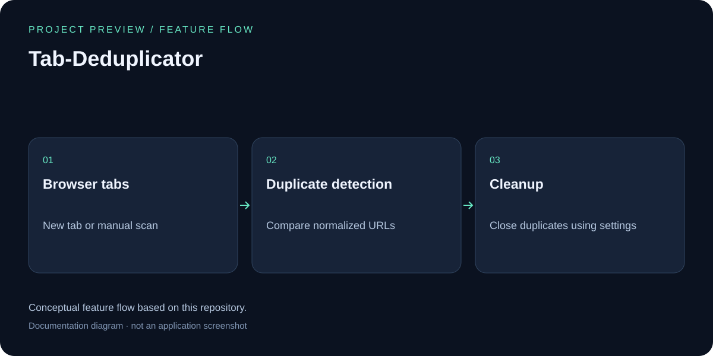

# Tab Deduplicator

## Feature overview



Conceptual feature flow based on this repository; this is a documentation diagram, not an application screenshot.

🔄 A Firefox extension that automatically detects and closes duplicate tabs.

## Features

- **Auto Detection**: When you open a URL that already exists, automatically close the old tab and keep the new one
- **Manual Scan**: Manually scan all tabs to find duplicates
- **One-Click Cleanup**: Close all duplicate tabs with one click
- **Flexible Settings**:
  - Option to ignore URL hash (#) portion
  - Option to ignore URL query parameters (?)
  - Exclude specific domains from processing
- **Desktop Notifications**: Show notifications when duplicate tabs are closed

## Installation

### Temporary Installation (For Development/Testing)

1. Open Firefox and type `about:debugging` in the address bar
2. Click "This Firefox" on the left panel
3. Click "Load Temporary Add-on..."
4. Navigate to this project folder and select the `manifest.json` file

### Install from Firefox Add-ons

(Not yet published)

## Usage

1. After installation, click the extension icon in the toolbar
2. View current tab statistics
3. Click "Scan Duplicates" to find duplicate tabs
4. Click "Close All Duplicates" to clean up all duplicate tabs at once
5. Customize options in the settings page

## File Structure

```
Tab-Deduplicator/
├── manifest.json        # Extension manifest file
├── background.js        # Background script (core logic)
├── popup/
│   ├── popup.html      # Popup window HTML
│   ├── popup.css       # Popup window styles
│   └── popup.js        # Popup window logic
├── options/
│   ├── options.html    # Options page HTML
│   ├── options.css     # Options page styles
│   └── options.js      # Options page logic
├── icons/
│   ├── icon-48.svg     # 48x48 icon
│   └── icon-96.svg     # 96x96 icon
├── README.md           # Documentation (English)
└── README_zh.md        # Documentation (Chinese)
```

## Permissions

- `tabs`: Required to read and manage tabs
- `storage`: Required to save user settings
- `notifications`: Required to show desktop notifications

## Development

### Requirements

- Firefox 57+ (WebExtension API support)

### Converting SVG Icons to PNG

If you need PNG icons, use the following commands:

```bash
# Using Inkscape
inkscape -w 48 -h 48 icons/icon-48.svg -o icons/icon-48.png
inkscape -w 96 -h 96 icons/icon-96.svg -o icons/icon-96.png

# Or using ImageMagick
convert -background none icons/icon-48.svg icons/icon-48.png
convert -background none icons/icon-96.svg icons/icon-96.png
```

## License

MIT License
